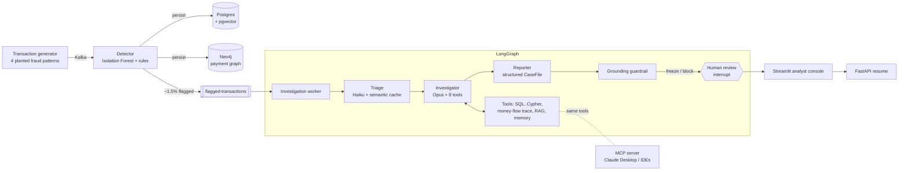

# Agentic Payment Fraud Investigator

A real-time fraud pipeline where a cheap anomaly detector screens every transaction and a
**LangGraph multi-agent system** investigates only the flagged ones. It gathers evidence from a
transaction database, a payment graph, a fraud playbook (RAG) and memory of past cases. It then
writes a case file in which every claim cites the tool output it came from, and **pauses for a
human analyst** before freezing any account.



## Why it's built this way

| Decision | Why |
|---|---|
| Detector first, LLM second | LLMs are too slow and expensive to run on every transaction. The detector sends only about 1.5% of traffic to the agent; that is the main cost control. |
| Model routing | A cheap model (Haiku) triages; a strong model (Opus) investigates and writes reports. Both are set in `.env`. |
| Semantic cache on triage | Flags with the same structure (e.g. `velocity: # payments in # min`) reuse an earlier triage decision instead of calling the LLM. |
| Every claim cites a `tool_call_id` | `grounding_check` is a *deterministic* guardrail. It drops claims citing tool calls that never happened, and downgrades "fraud" to "suspicious" with fewer than 2 grounded facts. |
| Human-in-the-loop via `interrupt()` | Account freezes are irreversible for the customer. State is checkpointed in Postgres, so a case can wait for review and resume in another process. |
| Tools are plain functions | `tools/core.py` is framework-agnostic. LangChain and MCP are each a thin wrapper around it. |
| Ground truth never reaches the agent | `is_fraud` is stored for evals only; no tool selects it. |
| Deterministic data | Seeded generator, so the same seed gives the same eval set (needed for CI regression gates). |

## Tech stack

| Area | Tools |
|---|---|
| Agents | LangGraph (state graph, ToolNode, Postgres checkpointer, `interrupt`/resume), LangChain, Claude (Haiku + Opus) |
| Retrieval and memory | pgvector via langchain-postgres, FastEmbed embeddings, Redis semantic cache |
| Graph | Neo4j (Cypher) |
| Streaming and ML | Kafka (Redpanda), scikit-learn Isolation Forest |
| Serving | FastAPI, Streamlit, MCP server |
| Quality | LLM-as-judge evals, pytest, LangSmith tracing, GitHub Actions |
| Infra | Docker Compose, uv |

## Quickstart

Prerequisites: Docker Desktop, [uv](https://docs.astral.sh/uv/), and an Anthropic API key.

```bash
cp .env.example .env              # then set ANTHROPIC_API_KEY (and LANGSMITH_* if you want traces)
uv sync
docker compose up -d --wait

# One-time data setup (deterministic)
uv run python -m fraud_agent.detector.train          # trains detector + prints its precision/recall
uv run python -m fraud_agent.generator.producer --seed-db
uv run python -m fraud_agent.detector.backfill --count 20000
uv run python -m fraud_agent.tools.retrieval --ingest
uv run python -m evals.build_dataset
```

Run the apps (one terminal each):

```bash
uv run uvicorn fraud_agent.api.main:app --port 8000            # API
uv run streamlit run src/fraud_agent/ui/app.py                  # analyst console
```

Investigate a single flagged transaction:

```bash
uv run python -m fraud_agent.agents.graph <TXN_ID>
```

Or run the live streaming pipeline (three more terminals):

```bash
uv run python -m fraud_agent.detector.consumer
uv run python -m fraud_agent.agents.worker
uv run python -m fraud_agent.generator.producer --rate 20
```

Redpanda Console (watch the topics): http://localhost:8080 · Neo4j browser: http://localhost:7474 (neo4j / fraudgraph)

> **Windows note:** if `uv sync` installs fine but imports fail with *"The filename or extension is
> too long"*, the project path is too deep. Move the repo to a shorter path or set
> `UV_PROJECT_ENVIRONMENT=C:\venvs\fraud-investigator`.

### Use the tools from Claude Desktop (MCP)

Add to `claude_desktop_config.json`, then ask Claude to "investigate transaction TX…":

```json
{
  "mcpServers": {
    "fraud-investigation": {
      "command": "uv",
      "args": ["--directory", "C:/path/to/fraud-investigator", "run", "python", "-m", "fraud_agent.mcp_server"]
    }
  }
}
```

The MCP server is **read-only** by design: it cannot freeze accounts.

### Tracing

Set `LANGSMITH_TRACING=true` and `LANGSMITH_API_KEY` in `.env`. Every LangChain/LangGraph call is
traced with no code changes, tagged with the prompt version.

## Evals

```bash
uv run python -m evals.run_evals --limit 10        # smoke run (~10 cases)
uv run python -m evals.run_evals                   # full 50-case set
```

Fifty labelled cases: 8 per fraud pattern plus 18 false-positive flags. They measure:

- **Detection:** precision, recall, F1, and accuracy on the fraud pattern.
- **False-action rate:** legitimate customers the agent would freeze or block.
- **Ungrounded claim rate:** citations the guardrail had to drop.
- **LLM-as-judge:** faithfulness and actionability scores.
- **Efficiency:** average tool calls, cost per case, p50/p95 latency.

Results are written to `evals/results/` as JSON plus a Markdown summary (`latest.md`). CI runs the unit tests on
every PR, and, if the repo has an `ANTHROPIC_API_KEY` secret, a 15-case eval that **fails the build
if F1 drops below 0.75**.

Tests:

```bash
uv run pytest -q    # 8 offline unit tests + 1 graph integration test (scripted fake LLM, needs docker)
```

## Results

**Detector** (offline, `fraud_agent.detector.train`, 30k-transaction labelled stream):

| metric | value |
|---|---|
| precision | 0.64 |
| recall | 0.62 |
| share of traffic sent to the LLM | 1.5% |
| recall: account takeover / mule chain / merchant collusion / velocity burst | 1.00 / 1.00 / 0.39 / 0.75 |

**Agent** (`evals.run_evals --limit 10`: the same 10 cases in every run, covering all four fraud
patterns plus false-positive flags; Opus 5.5 investigator/reporter, Haiku 5.5 triage and judge):

| metric | v1 | v2: reporter fix | v2 + realistic data | v3: pattern definitions |
|---|---|---|---|---|
| F1 (fraud vs. legitimate) | 0.94 | 0.94 | 1.00 | **1.00** |
| fraud pattern accuracy | 7/8 | 7/8 | 7/8 | **8/8** |
| false-action rate (freeze/block on a legitimate customer) | 0.00 | 0.00 | 0.00 | 0.00 |
| legitimate customers cleared with no action | 0/2 | 1/2 | 2/2 | **2/2** |
| ungrounded claim rate | 0.00 | 0.00 | 0.00 | 0.00 |
| LLM judge: faithfulness / actionability (1-5) | 4.6 / 4.2 | 4.3 / 4.7 | 4.4 / 4.4 | 4.3 / 4.9 |
| avg tool calls per case | 9.5 | 9.7 | 10.0 | **8.9** |
| avg cost per case | $0.23 | $0.24 | $0.19 | **$0.16** |
| latency p50 / p95 | 49 s / 52 s | 53 s / 60 s | 52 s / 71 s | **44 s / 51 s** |

What changed between runs:
- **v1 → v2 (prompt):** the reporter sometimes re-judged the case and overrode the investigator's
  "legitimate" verdict. The reporter prompt now treats the investigator's findings note as the
  decision, and allows a change only when a specific tool result contradicts it, citing that result.
- **v2 → realistic data:** in v2 the reporter's one change was a *correct* catch. The synthetic data
  packed all 20k transactions into 9.5 hours (about 5 payments per customer per hour), so normal
  customers looked like velocity bursts. The generator now spaces normal payments about a minute
  apart: 20k transactions cover two weeks at about 3 payments per customer per day.
- **v3 (prompt):** the first hop of a mule chain was labelled "account takeover", because from the
  victim's side it has the same signals (new device, new city, very large amount). The investigator
  prompt now defines each pattern by the scheme rather than the first transaction: if the funds are
  forwarded onward, it is a mule chain. It also traces the money before naming a pattern whenever
  funds go to a person. Real takeovers, where the funds stay put, are still labelled correctly. The
  clearer definitions also cut tool calls, cost and latency.

These are single runs on a 10-case sample, so small differences (such as the judge scores) are
within run-to-run noise.

## Project layout

```
src/fraud_agent/
  generator/   world.py (accounts, mules, merchants) · patterns.py (normal + 4 fraud patterns) · producer.py (Kafka)
  detector/    features.py (streaming features + rules) · model.py · train.py · consumer.py · backfill.py
  tools/       core.py (SQL + Cypher tools) · retrieval.py (pgvector RAG + case memory)
               semantic_cache.py · langchain_tools.py
  agents/      graph.py (LangGraph workflow) · prompts.py · llm.py (routing + cost) · worker.py
  api/main.py  FastAPI: cases, investigate, human decision (resume), metrics
  ui/app.py    Streamlit analyst console
  mcp_server.py
data/playbook/ fraud playbook markdown (the RAG corpus)
evals/         build_dataset.py · run_evals.py
tests/         offline unit tests + fake-LLM graph integration test
```

## Future work

- Improve detector recall on merchant collusion and velocity bursts, e.g. payee-side features, or flagging the whole burst once one transaction trips a rule.
- Hybrid search for the playbook (BM25 + vectors + reranker), measured by retrieval hit-rate.
- Graph-level mule-ring detection with Cypher or Neo4j GDS community detection.
- Batched writes in the detector consumer (currently about 30 tx/s with row-by-row writes).
- Prompt caching for the investigator's system prompt and tools, plus a cost-per-case dashboard.
- Containerised deployment of the API, worker and UI to AWS (ECS or App Runner) with managed Postgres.
